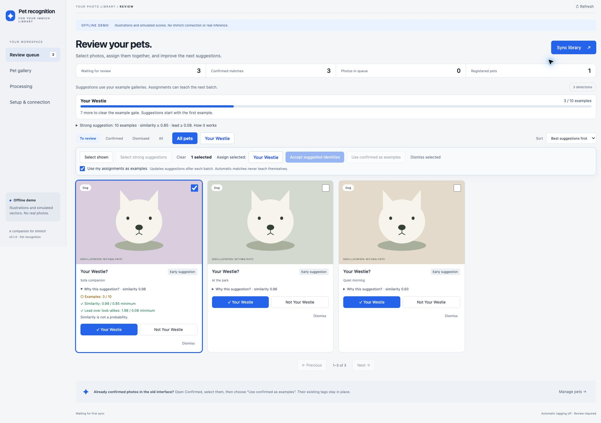

# Immich Pet Recognition

A self-hosted pet recognition companion for Immich. Find dogs and cats once, cache their crops,
compare them with your pets' reference galleries, and write confirmed identities as Immich tags.

**Initial implementation.** The API adapter targets Immich 3.2+ and was developed against the
3.3.1 OpenAPI contract. Automatic tagging is off by default. Similarity thresholds need calibration
on your own photos; a score is not a probability. CUDA deployment must be verified on your NAS.

## What it does

- Persistent SQLite queue with retries and restart recovery.
- Incremental API polling and an existing-library scan.
- RF-DETR Nano detection and Open Noodle Pet Recognition Large ONNX embeddings.
- Separate, versioned detection and embedding caches; recognition changes reuse crops.
- Multiple named pets, positive references, and per-pet negative examples.
- A companion review UI, explicit confirmation, and idempotent `Pets/<name>` tag writeback.
- No direct Immich database access. Stock Immich human recognition continues independently.

Video, pet entries in People, workflow event hooks, model ensembles, and reference removal are
future work. It is a single-instance service for one Immich account.

## Try the interface locally

```sh
uv sync --extra cpu
PET_DEMO=true PET_DATA_DIR=./data/demo uv run immich-pets
```

Open http://127.0.0.1:8090. Demo mode uses **synthetic illustrations and simulated scores**.
It downloads no models, connects to no Immich instance, and writes no tags. Use a separate
data directory for demo and real operation.

## Deploy on the UGREEN NAS with the RTX 3080

The NAS needs a working NVIDIA driver and NVIDIA Container Toolkit. Merely detecting the card
in the host does not mean Compose containers can access it. Keep Immich's ML container if you
also use its smart search/human-face detection; GPU memory is shared with this service.

1. Copy `.env.example` to `.env` and set `PET_IMMICH_URL`, `PET_IMMICH_API_KEY`, and
   `PET_SERVICE_TOKEN`. Generate the service token with:

   ```sh
   python3 -c "import secrets; print(secrets.token_urlsafe(32))"
   ```

2. Create an Immich API key with `asset.read`, `asset.view`, `tag.create`, and `tag.asset`.
   Use the URL of Immich's server, optionally ending in `/api`. No original-download permission
   is required; recognition uses the unedited preview. Hidden, locked, trashed, and offline
   assets are excluded. Keep the API key in the environment, not in the browser.

3. Choose a network arrangement:
   - **Same Compose project:** copy this checkout alongside Immich's Compose file, add both
     pet Compose files with `-f`, and adjust their `build.context` to the checkout directory.
     Both services will share the default network. `http://immich-server:2283` then resolves.
   - **Separate Compose project:** use the NAS's reachable Immich URL (for example
     `http://192.168.1.20:2283`), or attach the pet service to Immich's existing Docker network.
     A service name from another default Compose network will not resolve automatically.

4. Build and run:

   ```sh
   docker compose -f compose.yaml -f compose.cuda.yaml up -d --build
   ```

   For CPU-only operation, use `docker compose up -d --build` instead.

5. The supplied port binds to NAS loopback. Reach it through your existing HTTPS reverse proxy
   or an SSH tunnel (`ssh -L 8090:127.0.0.1:8090 user@nas`). Open the UI and enter the
   **service token**, not the Immich API key. All photo and management endpoints require it.

   For direct access on a trusted home network, set `PET_AUTH_REQUIRED=false` and restart.
   The UI will open without a token in any browser. Anyone who can reach the service can then
   view photo crops and use its management/tagging controls; keep this port behind your
   trusted network or an authenticated reverse proxy. The Immich API key remains on the server.
   An empty service token does not disable authentication by itself: the service refuses to
   start unless you explicitly opt into direct access.

6. Register your pet. Scan the library, then add 30–50 varied crops as references. Add look-alike
   dogs as negative examples. Confirm matches manually; confirmed matches are tagged even with
   automatic tagging disabled. Failed writes appear on the crop card; retry them in Processing.

The first real scan downloads pinned model weights from Hugging Face. RF-DETR Nano is small;
the Large recognizer is approximately 1.2 GB. Models run locally after download. The CUDA
runtime refuses silent CPU fallback if the requested provider fails to initialize.

## Review and examples

Select photo crops and click a named pet button to assign the whole selection. There is no
global pet dropdown. **Use my assignments as examples** is checked by default; leave it on
to teach the gallery from your explicit assignments, or turn it off to reserve those photos
for a separate accuracy check. Model-generated automatic matches never add their own examples.

Suggestions for visible photos use the latest cached example vectors immediately. A background
pass refreshes rankings across the library without downloading photos or running detection again.
The UI shows when that pass is pending. Manual decisions and published tags survive rematching.
Use **Not [pet]** to exclude that identity while leaving the crop available for another pet;
**Dismiss** removes the crop from the pending queue without guessing a negative identity.

The progress cards and every suggestion expose the three matching gates: **10 examples**, cosine
similarity **0.85**, and separation from competing identities/negative examples **0.08** by default.
Suggestions can appear with the first example. A **strong suggestion** passes all three gates;
it is not a calibrated probability or a guarantee of correct identity. **Select strong suggestions**
and **Accept suggested identities** approve the selected photos together, using each photo's
own suggested pet. Selection is limited to the displayed page (up to 48 crops).

To teach from photos confirmed in the original interface, open **Confirmed**, select photos,
and choose **Use confirmed as examples**. This also works for already-tagged photos and does not
rewrite their tags. Batch results report individual failures instead of silently losing them.

To correct an assignment, open **Confirmed**, filter to the wrong pet, select the affected crops,
and click the correct pet's name. Published tags can be reassigned. The correct tag is added,
then the old tag is removed when no other confirmed animal in that photo still needs it.
With the examples option enabled, the crop becomes a positive example for the correct pet and
a negative example for the old pet. Conflicting positive examples are removed.

To untag without assigning another pet, select confirmed crops and choose **Remove tags**, or
use **Remove tag** on a card. This removes the assignment and its positive example and moves
the crop to **Dismissed**; the photo itself is retained. Failed tag changes remain visible and
can be retried in **Processing**. Pending removals survive restarts and are verified against Immich.

## Automatic tagging

Check performance on a held-out set that is not in the reference gallery. Tune the similarity
threshold and separation margin to avoid confusing look-alikes. The initial values (0.85/0.08)
are placeholders, not model-vendor recommendations or proven accuracy guarantees.

Set `PET_AUTO_TAG=true` only after calibration and restart the service. A match must clear both
thresholds and have at least `PET_MIN_REFERENCES` positive references. Explicitly rejected or
confirmed decisions survive rematching. Confirmed tags are additive; the service never removes
unrelated tags. Published assignments can be corrected or removed from the review UI. Only explicit human assignments
with the examples option enabled, or an explicit example action, change the reference gallery.

## Cache, persistence, and upgrades

Back up the `pet-data` volume: it holds SQLite, crops, and downloaded models. SQLite is configured
with WAL; use SQLite's backup API or stop the service before copying the database files. Never
commit the data directory or `.env`. Run exactly one service instance and one Uvicorn process.

Models are pinned to Hub revisions in `config.py`; repo/revision can be overridden with
`PET_DETECTOR_REPO`, `PET_DETECTOR_REVISION`, `PET_RECOGNIZER_REPO`, and
`PET_RECOGNIZER_REVISION`. After a recognition-model change, scan the existing library to enqueue
the new pipeline. Cached crops and reference images are re-embedded for the new model; detection
is reused. Model adapters must share the documented I/O contract, or implement their own protocol.

Latest Immich releases are not automatically guaranteed compatible. The connector checks the
minimum version and validates expected responses. An upgrade that changes its API should produce
a visible error and be tested before scanning again.

## Development

```sh
uv sync --extra cpu
uv run pytest
uv run ruff check .
uv run ruff format --check .
```

See [architecture](docs/architecture.md) and [validation](docs/validation.md).

For a real model smoke check on a local photo, without connecting to Immich:

```sh
uv run --extra cpu python scripts/smoke_models.py /path/to/dog-photo.jpg
# On the NVIDIA host, inside the CUDA runtime:
python scripts/smoke_models.py /path/to/dog-photo.jpg --cuda
```



## Model sources

The ONNX adapters follow the publishers' input/output contracts. Model downloads use pinned Hub
revisions, without remote Python code execution. Model licenses are separate from this repository.

- [RF-DETR Nano](https://huggingface.co/open-noodle/rfdetr-nano): Apache 2.0; 384×384 RGB,
  ImageNet normalization, normalized box coordinates, COCO 91-class logits.
- [Pet Recognition Large](https://huggingface.co/open-noodle/pet-recognition-large): Apache 2.0;
  224×224 RGB, ImageNet normalization, 512-dimensional identity embeddings.
- [Immich 3.3.1 API contract](https://github.com/immich-app/immich/blob/v3.3.1/open-api/immich-openapi-specs.json)
