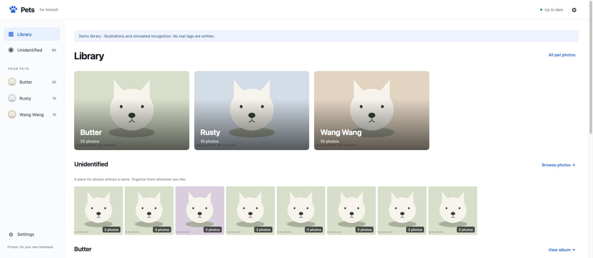

# Immich Pet Recognition

A self-hosted pet recognition companion for Immich. Find dogs and cats once, cache their crops,
recognize your pets from the identities you confirm, and sort their photos with Immich tags.

The API adapter targets Immich 3.2+. CPU and CUDA Compose configurations are included.
Newly named pets sort automatically; existing saved pause choices are preserved.

## What it does

- Persistent SQLite queue with retries and restart recovery.
- Incremental API polling and an existing-library scan.
- RF-DETR Nano detection and Open Noodle Pet Recognition Large ONNX embeddings.
- Separate, versioned detection and embedding caches; recognition changes reuse crops.
- Pet albums, learned matching policies, and batch naming of unidentified photos.
- Idempotent `Pets/<name>` tag writeback, with corrections and durable retries.
- No direct Immich database access. Stock Immich human recognition continues independently.

Video, pet entries in People, workflow event hooks, and model ensembles are future work. It is a single-instance service for one Immich account.

## Try the interface locally

```sh
uv sync --extra cpu
PET_DEMO=true PET_DATA_DIR=./data/demo uv run immich-pets
```

Open http://127.0.0.1:8090. Demo mode uses **synthetic illustrations and simulated scores**.
It downloads no models, connects to no Immich instance, and writes no tags. Use a separate
data directory for demo and real operation.

## Deploy on the UGREEN NAS with the RTX 3080

The NAS needs a working NVIDIA driver and NVIDIA Container Toolkit. Merely detecting the card
in the host does not mean Compose containers can access it. Keep Immich's ML container if you
also use its smart search/human-face detection; GPU memory is shared with this service.

1. Copy `.env.example` to `.env` and set `PET_IMMICH_URL`, `PET_IMMICH_API_KEY`, and
   `PET_SERVICE_TOKEN`. Generate the service token with:

   ```sh
   python3 -c "import secrets; print(secrets.token_urlsafe(32))"
   ```

2. Create an Immich API key with `asset.read`, `asset.view`, `tag.create`, and `tag.asset`.
   Use the URL of Immich's server, optionally ending in `/api`. No original-download permission
   is required; recognition uses the unedited preview. Hidden, locked, trashed, and offline
   assets are excluded. Keep the API key in the environment, not in the browser.

3. Choose a network arrangement:
   - **Same Compose project:** copy this checkout alongside Immich's Compose file, add both
     pet Compose files with `-f`, and adjust their `build.context` to the checkout directory.
     Both services will share the default network. `http://immich-server:2283` then resolves.
   - **Separate Compose project:** use the NAS's reachable Immich URL (for example
     `http://192.168.1.20:2283`), or attach the pet service to Immich's existing Docker network.
     A service name from another default Compose network will not resolve automatically.

4. Build and run:

   ```sh
   docker compose -f compose.yaml -f compose.cuda.yaml up -d --build
   ```

   For CPU-only operation, use `docker compose up -d --build` instead.

5. The supplied port binds to NAS loopback. Reach it through your existing HTTPS reverse proxy
   or an SSH tunnel (`ssh -L 8090:127.0.0.1:8090 user@nas`). Open the UI and enter the
   **service token**, not the Immich API key. All photo and management endpoints require it.

   For direct access on a trusted home network, set `PET_AUTH_REQUIRED=false` and restart.
   The UI will open without a token in any browser. Anyone who can reach the service can then
   view photo crops and use its management/tagging controls; keep this port behind your
   trusted network or an authenticated reverse proxy. The Immich API key remains on the server.
   An empty service token does not disable authentication by itself: the service refuses to
   start unless you explicitly opt into direct access.

6. Name your pets and scan the library. Automatic sorting is on for newly registered pets.
   Confirm a group when the identity is uncertain; every identification helps future sorting.
   Open a pet collection to correct or remove a tag. Failed writes can be retried in Background activity.

The first real scan downloads pinned model weights from Hugging Face. RF-DETR Nano is small;
the Large recognizer is approximately 1.2 GB. Models run locally after download. The CUDA
runtime refuses silent CPU fallback if the requested provider fails to initialize.

## Your pet library

**Library** opens with pet portraits and photo previews. Open an album to browse its **Photos**:
manual and automatic identities appear together as complete Immich photo previews. Each photo
appears once, including photos with several animals; identification close-ups stay in Unidentified.
Select incorrect results to move them to another pet or remove their name. Removing a name
retains the photo. The correct tag is added before an old tag is removed; a tag stays if another
confirmed animal in the same photo needs it. Manual naming also corrects a wrong cat/dog label.

An album's **More photos** tab shows its closest plausible additional matches, ordered by relevance.
Select matching photos and add them to the pet together, including photos from several internal
similarity groups. Select shown is available for larger batches; nothing is preselected for you.
Other animals remain in Unidentified. Suggestions stay separate from saved album members until added.

**Unidentified** is a visual contact sheet of similar photos. Select several groups and name them
together using the fixed assignment bar, rather than answering the same pet question for each
group. Open a group to inspect its members when needed. Photos that cannot yet be identified
can stay here; there is no requirement to clear a review queue before enjoying the albums.

Naming and correction update the interface while recognition and Immich tag sync run in the
background. The current gallery stays available during sorting. Undo is available for the latest
batch action, and a small activity indicator opens progress and retry details. Failed writes and
pending removals survive restart.

Every manual name or correction improves recognition automatically, including older names.
There is no reference checkbox, enrollment step, or training/validation choice. Automatic results
never teach themselves. See [the product design contract](docs/design.md) for the workflow and
the reasons behind it.

## Automatic sorting

**Settings** offers **Fewer mistakes**, **Balanced**, and **Sort more**, plus per-pet
pause controls. Preferences persist without a restart. A paused pet keeps its existing tags;
unpublished automatic writes are canceled, while human assignments remain queued for publication.
New pets default to automatic sorting on. Existing saved pause choices are preserved.

Adaptive matching fits a separate boundary for each pet from explicit feedback. It tests each
known photo with all of that photo's crops removed from every pet's gallery, uses other known pets
and explicit rejections as contrasts, and searches for a boundary that recovers known identities
without confusing them. Well separated identities use the observed gap between their score
ranges instead of requiring near-duplicate similarity. The preferences change how much separation
and past-label precision the search requires. The report describes checks on previous feedback;
it is not a calibrated probability or a guarantee of accuracy on unseen animals. Contradictory
identities remain unidentified. The pretrained image encoder itself is not retrained.

Matching uses cached embeddings, without downloading photos or rerunning detection. Activity
details show queued/preparing/running percentage, checked/total crops, completion, and errors
with retry. Percentage measures the current pass, not the proportion of photos tagged. Tag
syncing is tracked separately. Interrupted passes recover on restart, and human decisions are
never overwritten by rematching. Only the latest completed progress record is retained.

`PET_MATCHING_MODE=adaptive` is the default. The read-only `/api/matching` report can preview a
mode or preference before activation; `PUT /api/matching` saves the preference and rechecks the
backlog. Advanced deployments can retain `fixed` mode using the old environment thresholds;
0.85/0.08 are legacy placeholders, not model-vendor recommendations. `PET_AUTO_TAG` remains the
fallback for older pets without a saved choice. Explicit per-pet choices take precedence.

## Cache, persistence, and upgrades

Back up the `pet-data` volume: it holds SQLite, crops, and downloaded models. SQLite is configured
with WAL; use SQLite's backup API or stop the service before copying the database files. Never
commit the data directory or `.env`. Run exactly one service instance and one Uvicorn process.

Models are pinned to Hub revisions in `config.py`; repo/revision can be overridden with
`PET_DETECTOR_REPO`, `PET_DETECTOR_REVISION`, `PET_RECOGNIZER_REPO`, and
`PET_RECOGNIZER_REVISION`. After a recognition-model change, scan the existing library to enqueue
the new pipeline. Cached crops and reference images are re-embedded for the new model; detection
is reused. Model adapters must share the documented I/O contract, or implement their own protocol.

Latest Immich releases are not automatically guaranteed compatible. The connector checks the
minimum version and validates expected responses. An upgrade that changes its API should produce
a visible error and be tested before scanning again.

## Development

```sh
uv sync --extra cpu
uv run pytest
uv run ruff check .
uv run ruff format --check .
```

See [product design](docs/design.md), [architecture](docs/architecture.md), and
[validation](docs/validation.md).

For a real model smoke check on a local photo, without connecting to Immich:

```sh
uv run --extra cpu python scripts/smoke_models.py /path/to/dog-photo.jpg
# On the NVIDIA host, inside the CUDA runtime:
python scripts/smoke_models.py /path/to/dog-photo.jpg --cuda
```



## Model sources

The ONNX adapters follow the publishers' input/output contracts. Model downloads use pinned Hub
revisions, without remote Python code execution. Model licenses are separate from this repository.

- [RF-DETR Nano](https://huggingface.co/open-noodle/rfdetr-nano): Apache 2.0; 384×384 RGB,
  ImageNet normalization, normalized box coordinates, COCO 91-class logits.
- [Pet Recognition Large](https://huggingface.co/open-noodle/pet-recognition-large): Apache 2.0;
  224×224 RGB, ImageNet normalization, 512-dimensional identity embeddings.
- [Immich 3.3.1 API contract](https://github.com/immich-app/immich/blob/v3.3.1/open-api/immich-openapi-specs.json)
