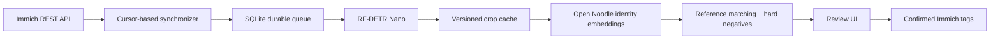

# Architecture

## Boundaries

The connector knows about Immich. Detector and recognizer protocols know about images and
embeddings. The service coordinates those stages and owns its metadata. FastAPI exposes the
authenticated review UI and commands. One background thread serializes model work while the
HTTP event loop stays available. SQLite owns the persistent queue; no Redis is needed for v1.

Detection cache keys include asset ID, source revision, detector revision, and confidence threshold.
The source revision derives from the original checksum, modification time, and thumbnail hash,
excluding metadata `updatedAt` so our tag writes cannot cause infinite inference loops. Crops use
preview coordinates; they are not projected into Immich People in this implementation.

Embedding cache keys include detection ID and recognizer revision. Reference membership survives
recognizer changes: the current model re-embeds the retained reference crops. Matching uses the
mean of the best three positive similarities per pet and requires separation from the best rival
pet or per-pet negative. Pet species must match. With no reference gallery, detections still reach
review without an identity guess.

## Reliability

Jobs transition `queued -> processing -> completed`; failures retry twice with backoff before
becoming `failed`. On startup interrupted jobs return to `queued`. Unique job keys deduplicate
overlapping syncs. Detection passes, including zero-pet results, are recorded separately so retries
and recognition changes do not repeat detection.

Incremental scans checkpoint their start time only after all pages succeed, with a one-minute
overlap. Failed partial scans retain enqueued work without advancing the watermark. Every
processing and publication action checks the current asset revision and eligibility. Stale crops
are hidden from the current queue. Tag writes are idempotent and checked for per-asset failure,
including HTTP-200 bulk responses that contain errors. Failed writes need an explicit retry.

Human review decisions are stored per detection/model. Confirmed/rejected decisions are never
overwritten by rematching under that model. Switching models creates fresh review records, while
leaving already-published Immich tags intact. A decision lock prevents a human rejection racing
with publication. Explicit corrections can replace or remove the corresponding pet tag.

Bulk review validates each crop under the same decision lock. Valid rows are saved and invalid
or stale rows report individual errors. Published assignments can be corrected. An explicit human assignment can also
save a positive example in the same transaction. Correcting an identity removes conflicting
positive membership and records the prior identity as a negative. Automatic evaluation never
teaches the gallery. Existing confirmed crops can be enrolled in bulk without changing tags.

Corrections persist old tag associations in `tag_removals` in the same transaction as the local
assignment change. Publication adds the correct tag first, then removes old tags, and verifies
their absence through the asset API before marking the assignment published. Another confirmed
animal in the same photo can keep an old tag. Pure removal moves the crop to rejected, removes
its positive example, and queues tag removal without deleting the photo. Failed operations keep
their durable removal records and retry idempotently; writeback runs before gallery rematching.
Clients can supply the expected old pet ID to reject stale corrections.

Gallery revisions persist in SQLite so unfinished rematching resumes after a restart. A rematch
reuses the gallery vectors for the pass and releases the model lock between crops to keep review
responsive. Visible suggestions compare cached vectors on request, without inference or writeback;
their response includes each matching gate. Best-first ordering across the library follows the
background rematch. The UI preserves active selections and avoids redrawing unchanged card data.

## Scope and operational limits

One Immich account and one running process. No distributed workers, arbitrary plugin loading,
People writeback, video sampling, schema-migration framework, or automated deletion/retention yet.
The detector/recognizer protocols are code extension points; this is not a plugin marketplace.
Cache growth is unbounded in v1. Runtime status reports errors, but health currently proves only
that the HTTP service is running, not that Immich or CUDA inference is ready.

The service token protects data/control endpoints by default; the UI shell and health endpoint are public.
`PET_AUTH_REQUIRED=false` explicitly opts into direct access for trusted networks. In that mode,
write requests from other browser origins are rejected, and the Immich API key remains server-side.
Use HTTPS or a trusted SSH tunnel for remote access. No third-party scripts, web fonts, or analytics
are loaded. Demo illustrations and scores are synthetic and isolated from real inference.
